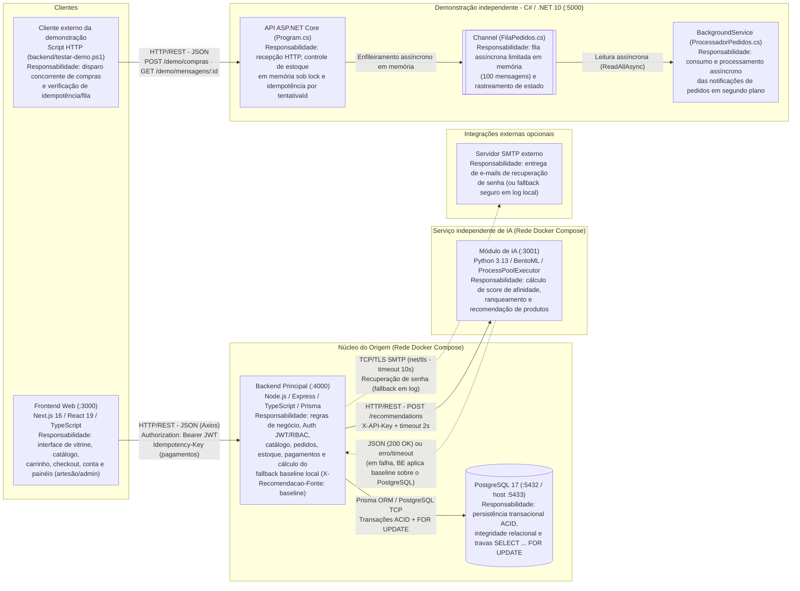

# Origem

### Marketplace da Economia Criativa e do Artesanato de Pernambuco

**Projeto Integrador, ADS**
**CESAR School, 4º Semestre, 2026.2**

> **Avaliação de IA (AV2):** instruções de instalação, tabela de requisitos e casos de teste estão na seção [Módulo de IA](#módulo-de-ia-recomendação-de-produtos-av2).

## Sobre o projeto

O Origem é uma aplicação web full stack que conecta artesãos e empreendedores criativos de Pernambuco a compradores de todo o país.

A plataforma oferece uma vitrine e um canal de venda para quem produz, valorizando a técnica, a origem e a história de cada peça.

## Problema

Artesãos e produtores criativos enfrentam dificuldades relacionadas à:

* Baixa visibilidade digital;
* Dependência de intermediários;
* Gestão de catálogo;
* Gestão de pedidos;
* Controle de estoque.

O Origem busca criar um canal que conecte essa produção aos compradores, destacando a origem, a técnica e o impacto de comprar diretamente de quem produz.

## Solução

A plataforma reúne uma vitrine para compradores, ferramentas de gerenciamento para artesãos e um painel administrativo, integrando recursos de busca, compra, gestão e recomendação de produtos.

## Features

### Comprador

* Vitrine de produtos;
* Busca por produtos;
* Filtros por técnica e região;
* Visualização dos detalhes do produto;
* Perfil do artesão;
* Carrinho;
* Pedidos;
* Avaliações;
* Recomendação de produtos.

### Artesão

* Gerenciamento de catálogo;
* Controle de estoque;
* Gerenciamento de pedidos.

### Administrador

* Painel administrativo;
* Gestão da plataforma;
* Indicadores de venda.

### Inteligência Artificial

O projeto contempla um módulo de Inteligência Artificial voltado para:

* Recomendação de produtos;
* Classificação automática de produtos;
* Análise de sentimento das avaliações;
* Previsão de demanda, de forma opcional.

A recomendação parte de um baseline simples, considerando características como técnica, região e popularidade, antes de abordagens mais sofisticadas.

## Stack

### Frontend
- **Next.js 16 e React 19:** construção da aplicação web com App Router e React Compiler.
- **TypeScript:** tipagem estática e maior segurança no desenvolvimento.
- **Tailwind CSS 4 e Chakra UI 3:** layout/tokens visuais com Tailwind e componentes interativos com Chakra UI.
- **lucide-react e Axios:** ícones padronizados e cliente HTTP centralizado.

### Backend principal
- **Node.js e TypeScript:** implementação das APIs e regras de negócio.
- **Prisma ORM:** mapeamento de dados e acesso ao banco de dados.
- **PostgreSQL:** banco de dados relacional para usuários, artesãos, produtos, estoque, pedidos e demais informações da plataforma.

### Inteligência Artificial
- **Python:** implementação do módulo de recomendação de produtos.
- **BentoML:** disponibilização do serviço de recomendação por API.

### Concorrência
- **C# e .NET 10:** implementação da API demonstrativa de concorrência e processamento de pedidos em fila, mantida separadamente do backend principal.

### Testes e ferramentas
- **Jest e Cypress:** ferramentas de testes, conforme os fluxos e módulos em que forem utilizados.
- **pytest:** testes automatizados do módulo de IA.
- **Git e GitHub:** versionamento e colaboração da equipe.
- **Figma:** prototipação e design da interface.

## Arquitetura

O Origem integra os seguintes componentes implementados:

* Frontend web responsivo (`frontend/`);
* Backend principal e APIs REST (`backend/app/`);
* Banco de dados relacional PostgreSQL (`database/`);
* Módulo de Inteligência Artificial para recomendação (`modulo-ia/`);
* Autenticação e autorização JWT/RBAC (`backend/app/src/middleware/auth.ts`);
* Envio de e-mails de recuperação via SMTP sobre TCP/TLS com fallback em log (`backend/app/src/lib/email.ts`);
* Demonstração independente de concorrência e processamento assíncrono em fila (`backend/backend/Origem.Concorrencia/`).

> **Melhorias futuras (fora do escopo atual):** camada dedicada de cache distribuído e broker externo de mensageria.

O estado atual implementa o frontend integrado ao backend Express e PostgreSQL via `NEXT_PUBLIC_API_URL` (padrão `http://localhost:4000`), o serviço de recomendação em Python/BentoML (`http://localhost:3001`) consumido pelo backend com fallback local, além da API C# demonstrativa para compra concorrente (`http://localhost:5000`). O roteiro e os limites dessa demonstração estão em [`backend/README.md`](backend/README.md).

## Fluxo principal

```text
Buscar produto
      ↓
Aplicar filtros
      ↓
Visualizar produto
      ↓
Acessar perfil do artesão
      ↓
Adicionar ao carrinho
      ↓
Confirmar pedido
```

## Fluxos implementados

### Acesso e usuários
- Login
- Cadastro
- Recuperação de senha
- Perfil do comprador
- Perfil do artesão e edição
- Perfil do administrador

### Catálogo e produtos
- Home e vitrine
- Catálogo e busca
- Detalhes do produto
- Loja do artesão
- Cadastro de peça
- Personalização de peça
- Comparação de peças
- Recomendações personalizadas

### Compra
- Carrinho
- Checkout
- Pagamento
- Confirmação de pagamento
- Pagamento recusado
- Visualização de compras
- Acompanhamento do pedido

### Gestão do artesão
- Dashboard do artesão
- Gestão de estoque
- Gestão de pedidos
- Transporte e embalagem
- Avaliações
- Controle de peças únicas: disponível, reservada e vendida

### Administração
- Dashboard do administrador
- Validação de origem: pendente, aprovada e rejeitada
- Moderação de conteúdo

### Suporte e IA
- Central de suporte
- Chat com IA para triagem
- Escalonamento para atendimento humano

### Estados e exceções
- Estado vazio
- Erro 500
- Confirmação
- Indisponibilidade
- Alerta de estoque baixo
- Estado de carregamento

## Integração com o backend

O frontend comunica-se diretamente com o backend Express (`backend/app/`) através do cliente HTTP centralizado em `frontend/src/lib/http.ts`, utilizando o fluxo:

**Frontend → API Express (`NEXT_PUBLIC_API_URL`, padrão `http://localhost:4000`) → Prisma ORM → PostgreSQL**

Autenticação JWT, persistência dos dados, estoque, pedidos, frete, avaliações, suporte, personalizações e painéis administrativos são processados e persistidos pelo backend no PostgreSQL.

## Integração entre disciplinas

O projeto integra as contribuições das disciplinas do 4º semestre:

* **Desenvolvimento Web:** construção da aplicação web full stack, frontend, backend e APIs;
* **Modelagem e Projeto de Banco de Dados:** modelagem e estruturação dos dados;
* **Requisitos, Projeto de Software e Validação:** análise de domínio, requisitos, arquitetura e testes;
* **Fundamentos de Computação Concorrente, Paralela e Distribuída:** concorrência, processamento assíncrono, distribuição e desempenho;
* **Engenharia de Software e IA:** recomendação, classificação automática e análise de sentimento.

## Escopo e limitações

O projeto possui escopo controlado para o período letivo, considerando:

* Poucas categorias de produtos;
* Dados representativos e sintéticos;
* Recomendação e classificação em nível didático;
* Pagamento simulado, sem gateways reais;
* Distribuição limitada.

Também são considerados o respeito à origem cultural e a autoria das peças.

## Objetivo

Desenvolver uma aplicação web full stack que conecte artesãos e empreendedores criativos de Pernambuco a compradores de todo o país, valorizando a origem, a técnica e a história dos produtos.

O projeto busca integrar, em um único produto, as contribuições das diferentes disciplinas do Projeto Integrador, incluindo desenvolvimento web, banco de dados, requisitos, concorrência e Inteligência Artificial.

## Execução

**Requisitos:** Git, Docker Desktop e Node.js 20+ com npm. Compatível com Windows, macOS e Linux.

### 1. Clonar o repositório

```bash
git clone https://github.com/Samara020/Projeto-Integrador-Origem.git
cd Projeto-Integrador-Origem
```

### 2. Configurar as variáveis de ambiente

Na raiz do projeto, crie um arquivo `.env` com base no arquivo `.env.example` e configure a senha do PostgreSQL.

```bash
# Windows PowerShell
Copy-Item .env.example .env
```

Edite o arquivo `.env` e substitua o valor de exemplo por uma senha local.

### 3. Iniciar o banco de dados

Com o Docker Desktop aberto, execute na raiz do projeto:

```bash
docker compose up -d
```

Para verificar se o contêiner está em execução:

```bash
docker compose ps
```

O PostgreSQL será disponibilizado na porta `5433` do computador.

**Observação:** os scripts SQL de inicialização são executados automaticamente somente quando o volume do banco é inicializado pela primeira vez. Se o volume já existir, execute os scripts necessários manualmente, conforme descrito em `database/README.md`.

### 4. Executar o frontend

```bash
cd frontend
npm install
npm run dev
```

Acesse [http://localhost:3000](http://localhost:3000).

### 5. Validar a compilação do frontend

Na pasta `frontend`, execute:

```bash
npm run build
```

### 6. Encerrar o banco de dados

Na raiz do projeto, execute:

```bash
docker compose down
```

Esse comando encerra os contêineres sem apagar os dados persistidos no volume do PostgreSQL.

## Módulo de IA: recomendação de produtos (AV2)

Mockup executável do módulo especificado na AV1 (HU-17, documento [`docs/Baseline de IA.pdf`](docs/Baseline%20de%20IA.pdf)). Trilha A: recomendação/ranqueamento com **BentoML**.

O serviço recebe um produto de referência ou filtros (categoria, técnica, região), compara os atributos dos produtos, calcula um score de relação, ordena os candidatos e devolve as recomendações com uma justificativa. Os dados são sintéticos e ficam em `modulo-ia/data/catalogo_origem.json` (14 produtos). O código fica em [`modulo-ia/`](modulo-ia/).

### Requisitos

- Git
- Python 3.13 ou superior

### Instalação

Na raiz do repositório clonado.

**Linux / macOS:**

```bash
python3 -m venv .venv-ia
source .venv-ia/bin/activate
pip install -r modulo-ia/requirements.txt
```

**Windows (PowerShell):**

```powershell
python -m venv .venv-ia
.\.venv-ia\Scripts\Activate.ps1
pip install -r modulo-ia\requirements.txt
```

> Se o PowerShell bloquear o `Activate.ps1`, rode antes `Set-ExecutionPolicy -Scope CurrentUser RemoteSigned`.

### Como subir

Com o ambiente ativado:

```bash
cd modulo-ia
bentoml serve app.service:RecommendationService --port 3001
```

O serviço está pronto quando aparecer `Service RecommendationService initialized`. Ele responde em `http://localhost:3001`. Deixe esse terminal aberto e rode os testes em outro.

### Endpoint

`POST /recommendations`

| Item | Valor |
|---|---|
| Cabeçalho obrigatório | `X-API-Key: origem-mockup-key` |
| Entrada | `product_id` (produto de referência) **ou** pelo menos um filtro: `category`, `technique`, `region`. Opcional: `limit` (padrão 5, de 1 a 20) |
| Saída (200) | `{"recommendations": [{"product_id", "score", "reason"}]}`, ordenada pelo score |
| Erros | `400` entrada ou limite inválido · `401` sem chave · `403` chave inválida · `404` produto inexistente |

### Requisitos da AV1 → endpoint

| Requisito da AV1 | Como aparece no endpoint `POST /recommendations` |
|---|---|
| RF-01 Receber produto de referência ou filtros | Corpo aceita `product_id` ou `category`, `technique`, `region` |
| RF-02 Selecionar candidatos elegíveis | Lista `recommendations` só traz produtos elegíveis do catálogo |
| RF-03 Considerar só produtos disponíveis | Produtos com `available: false` nunca aparecem na resposta |
| RF-04 Excluir o produto de referência | O `product_id` enviado nunca volta na lista |
| RF-05 Comparar categoria, técnica e região | Atributos comparados entre o contexto e cada candidato |
| RF-06 Calcular score de relação | Campo `score` (categoria 50%, técnica 30%, região 20%) |
| RF-07 Ordenar candidatos | Lista ordenada do maior para o menor `score` |
| RF-08 Quantidade padrão 5, máximo 20 | Campo `limit`; acima de 20 retorna `400` |
| RF-09 Informar justificativa | Campo `reason` de cada item |
| RF-10 Aplicar fallback | Critérios relaxados em etapas (categoria+técnica+região → … → só categoria) |
| RF-11 Retornar lista vazia | `{"recommendations": []}` quando não há candidatos |
| RF-12 Responder pela integração com o Origem | O endpoint é chamado pela rota `GET /produtos/recomendacoes` do backend quando `RECOMENDACAO_API_URL` está configurado |
| RNF-02 Validar entradas | Respostas `400` e `404` |
| RNF-03 Autenticação e autorização | Cabeçalho `X-API-Key`; respostas `401` e `403` |
| RNF-07 Indisponibilidade | Se o serviço cair, o frontend usa as sugestões locais e a página continua funcionando |

### Casos de teste

Com o serviço rodando (passo "Como subir"), abra **outro terminal** e rode os comandos abaixo.

#### Caso 1: recomendação a partir de um produto

Pede recomendações para o produto `prd_201` (Vaso Cerâmica Raízes: Arte e Decoração, Cerâmica, Zona da Mata).

**Linux / macOS:**

```bash
curl -s -X POST http://localhost:3001/recommendations \
  -H "Content-Type: application/json" \
  -H "X-API-Key: origem-mockup-key" \
  -d '{"product_id": "prd_201", "limit": 5}'
```

**Windows (PowerShell):**

```powershell
Invoke-RestMethod -Method Post -Uri http://localhost:3001/recommendations -Headers @{"X-API-Key"="origem-mockup-key"} -ContentType "application/json" -Body '{"product_id": "prd_201", "limit": 5}' | ConvertTo-Json -Depth 5
```

**Resultado esperado (HTTP 200):**

```json
{
  "recommendations": [
    { "product_id": "prd_213", "score": 1.0, "reason": "Recomendado por mesma categoria, mesma técnica artesanal, mesma região." },
    { "product_id": "prd_202", "score": 0.8, "reason": "Recomendado por mesma categoria, mesma técnica artesanal." },
    { "product_id": "prd_207", "score": 0.5, "reason": "Recomendado por mesma categoria." }
  ]
}
```

O que conferir: `prd_201` não aparece (RF-04); a lista está em ordem de score (RF-07); cada item tem justificativa (RF-09). Vêm só 3 itens, mesmo com `limit` 5, porque os outros produtos de Arte e Decoração estão reservados ou vendidos (RF-03).

#### Caso 2: recomendação só por filtro, sem produto de referência

Pede recomendações para a categoria `Literatura`.

**Linux / macOS:**

```bash
curl -s -X POST http://localhost:3001/recommendations \
  -H "Content-Type: application/json" \
  -H "X-API-Key: origem-mockup-key" \
  -d '{"category": "Literatura", "limit": 5}'
```

**Windows (PowerShell):**

```powershell
Invoke-RestMethod -Method Post -Uri http://localhost:3001/recommendations -Headers @{"X-API-Key"="origem-mockup-key"} -ContentType "application/json" -Body '{"category": "Literatura", "limit": 5}' | ConvertTo-Json -Depth 5
```

**Resultado esperado (HTTP 200):**

```json
{
  "recommendations": [
    { "product_id": "prd_209", "score": 1.0, "reason": "Recomendado por mesma categoria." },
    { "product_id": "prd_210", "score": 1.0, "reason": "Recomendado por mesma categoria." }
  ]
}
```

O que conferir: o módulo aceita só filtros (RF-01). O score é calculado apenas com o atributo informado, e a justificativa cita só esse atributo (RNF-06).

#### Caso 3: produto de referência inexistente

Pede recomendações para um produto que não existe no catálogo.

**Linux / macOS:**

```bash
curl -s -w "\nHTTP %{http_code}\n" -X POST http://localhost:3001/recommendations \
  -H "Content-Type: application/json" \
  -H "X-API-Key: origem-mockup-key" \
  -d '{"product_id": "prd_999", "limit": 5}'
```

**Windows (PowerShell):**

```powershell
try { Invoke-RestMethod -Method Post -Uri http://localhost:3001/recommendations -Headers @{"X-API-Key"="origem-mockup-key"} -ContentType "application/json" -Body '{"product_id": "prd_999", "limit": 5}' } catch { "HTTP " + $_.Exception.Response.StatusCode.value__; $_.ErrorDetails.Message }
```

**Resultado esperado (HTTP 404):**

```json
{"error": {"code": "PRODUCT_NOT_FOUND", "message": "Produto de referência não encontrado."}}
HTTP 404
```

O que conferir: a entrada é validada antes do processamento (RNF-02) e o erro vem com código e mensagem.

> Os resultados esperados estão formatados para leitura; o terminal pode mostrar o JSON numa linha só. Os acentos podem aparecer como código (`técnica`) ou trocados no Windows PowerShell 5.1 (`técnica`). O que importa são os ids, a ordem, os scores e o código HTTP.

Mais detalhes do módulo (estratégia, fallback, testes automatizados com `pytest`) estão em [`modulo-ia/README.md`](modulo-ia/README.md).

## Infraestrutura de Software · Unidade 2 (E1, E2, E3)

### Como rodar (um comando)

Requisito: Docker com Compose v2.

```bash
git clone https://github.com/Samara020/Projeto-Integrador-Origem.git
cd Projeto-Integrador-Origem
cp .env.example .env   # PowerShell: Copy-Item .env.example .env
docker compose up --build
```

- Frontend: http://localhost:3000
- Backend (API principal): http://localhost:4000 (health: `/health`)
- Módulo de IA: http://localhost:3001 (health: `/readyz`)
- PostgreSQL: `localhost:5433`

O backend aguarda o PostgreSQL ficar saudável (`depends_on: service_healthy`) e integra `GET /produtos/recomendacoes` ao módulo de IA (com fallback automático em caso de indisponibilidade). O frontend só sobe depois que o backend responde ao healthcheck.

### Testes

TDD documentado em [`docs/TDD.md`](docs/TDD.md): story map → tarefas → testes por nível.

| Nível | Ferramenta | Comando |
|---|---|---|
| Unitário | Jest + pytest + node:test | `npm run test:unit` |
| Backend | Jest + Supertest, banco exclusivo | `npm run test:backend` |
| API | Jest contra servidor real | `npm run test:api` |
| E2E | Cypress | `npm run test:e2e` |
| E2E, só o caminho crítico (`@smoke`) | Cypress | `npm run test:e2e:smoke` |
| Quarentena (`@flaky`) | Cypress, com novas tentativas | `npm run test:quarentena` |

Política de manutenção, tags e relatório de métricas (`npm run test:metricas`): [`docs/tas.md`](docs/tas.md).

### Pipeline e deploy

| Gatilho | Workflow | O que faz |
|---|---|---|
| push fora da main | `testes-commit.yml` | regressão completa |
| push/merge na main | `testes-merge.yml` | regressão + build das imagens + smoke test |
| todo dia 2h | `testes-agendados.yml` | regressão completa |
| manual | `testes-smoke.yml` | só os E2E `@smoke` |

O deploy do frontend é feito pela Vercel, ligada ao repositório pela integração Git. A Vercel só publica o frontend; o módulo de IA não é publicado nela.

- URL pública: https://projeto-integrador-origem.vercel.app/
- Execução vermelha: **link da run** · Execução verde: **link da run**

### Decisões

- **Multi-stage no frontend (deps → build → runtime):** a imagem final leva só o `.next/standalone`, sem código-fonte nem devDependencies. Imagem menor, menos superfície de ataque, roda como usuário `node` (sem root).
- **Multi-stage no módulo de IA (deps → test → runtime):** o pytest roda dentro do build; se falhar, a imagem não é gerada. A imagem final não leva a pasta `tests/`.
- **`NEXT_PUBLIC_*` como build args:** o Next grava essas variáveis no bundle no build; variáveis de servidor (`RECOMENDACAO_API_URL`) ficam como env de runtime.
- **Healthchecks + `depends_on: service_healthy`:** evita o backend subir antes do PostgreSQL estar saudável e evita o frontend subir antes do backend responder ao healthcheck.
- **Vercel só para o frontend:** o módulo de IA (Python/BentoML) não roda como container na Vercel, então ele sobe localmente com `docker compose up`. A Vercel publica apenas o frontend via integração Git.
- **`concurrency` no `testes-merge.yml`:** dois merges seguidos não fazem o job `imagens` rodar em paralelo.

### Uso de IA

Usamos o Claude (Anthropic) para gerar a primeira versão dos Dockerfiles, do `compose.yaml`, do job de deploy e do esqueleto do `docs/TDD.md` e desta seção. O grupo revisou, testou localmente e ajustou. A seção de jornada e lições do TDD foi escrita pelo grupo.

## Arquitetura Distribuída — Projeto Origem (FCCPD / Unidade 2)

### 1. Módulos existentes no repositório e suas responsabilidades

A solução reutiliza os componentes existentes no repositório, mantendo a separação de responsabilidades sem fragmentar artificialmente o sistema em microsserviços.

- **Frontend Web (`frontend/`):** aplicação em Next.js 16, React 19 e TypeScript responsável pela interface do marketplace, incluindo vitrine, catálogo, busca, detalhes dos produtos, carrinho, checkout, painel do artesão, painel administrativo e suporte. Não acessa diretamente o banco de dados nem o módulo de IA; consome exclusivamente o backend por meio do cliente HTTP centralizado (`frontend/src/lib/http.ts`).
- **Backend Principal (`backend/app/`):** API em Node.js, Express, TypeScript e Prisma ORM responsável pelas regras de negócio centrais, autenticação e autorização (JWT/RBAC), gestão de usuários, artesãos, produtos, estoque, pedidos, checkout/pagamentos (com `Idempotency-Key`), integração com o serviço de recomendação (incluindo cálculo local do *fallback baseline* sobre o PostgreSQL com cabeçalho `X-Recomendacao-Fonte: baseline`) e envio de e-mails de recuperação via SMTP nativo (`net`/`tls`) com fallback em log.
- **Serviço de Recomendação / IA (`modulo-ia/`):** serviço em Python 3.13 e BentoML responsável pelo cálculo de afinidade, ranqueamento e recomendação de produtos, disponibilizado em `POST /recommendations` para consumo do backend (`GET /produtos/recomendacoes` quando `RECOMENDACAO_API_URL` está configurado) e `POST /recommendations/batch` para pré-cálculo paralelo em lote (`ProcessPoolExecutor`) em testes e benchmarks.
- **Módulo de Concorrência e Fila (`backend/backend/Origem.Concorrencia/`):** implementação em C# e .NET 10 voltada à demonstração de concorrência (`lock` e idempotência por `tentativaId` em `EstoqueDemonstracao`) e processamento assíncrono de notificações de pedidos em fila (`Channel` limitado a 100 itens em `FilaPedidos.cs` + `BackgroundService` em `ProcessadorPedidos.cs`). É mantida separadamente do backend principal e acionada por cliente externo (`backend/testar-demo.ps1`), sem integrar o fluxo de checkout em produção.
- **Banco de Dados Relacional (`database/` e `backend/app/prisma/`):** PostgreSQL 17 como base de dados transacional principal para usuários, artesãos, produtos, estoque e pedidos, acessada pelo backend por meio do Prisma ORM com transações ACID e travas `SELECT ... FOR UPDATE`.
- **Servidor SMTP externo (opcional):** integração de saída a partir de `backend/app/src/lib/email.ts` via sockets TCP/TLS nativos (`net`/`tls`) para envio de e-mails de recuperação de senha; quando `SMTP_HOST` não está definido, aplica fallback seguro em log local.
- **Módulos de apoio (`aed/` e `e2e/`):** incluem análise de estruturas de dados e algoritmos, benchmarks em C++17 e TypeScript e testes automatizados ponta a ponta com Cypress. Não fazem parte do fluxo de requisições de produção.

### 2. Componentes que se comunicam e mecanismos utilizados

| Origem | Destino | Mecanismo de comunicação | Finalidade |
|---|---|---|---|
| **Frontend Web (`frontend/`)** | **Backend Principal (`backend/app/`)** | HTTP/REST com JSON (Axios), via `NEXT_PUBLIC_API_URL` (padrão `http://localhost:4000`), `Authorization: Bearer JWT` e `Idempotency-Key` (pagamentos) | Autenticação, consulta de catálogo, produtos e recomendações, carrinho, checkout, pedidos e painéis. |
| **Backend Principal (`backend/app/`)** | **PostgreSQL (`database/` / Prisma)** | Protocolo nativo PostgreSQL sobre TCP, por meio do Prisma ORM (`$transaction` + `FOR UPDATE`) | Persistência relacional ACID, operações transacionais de domínio (catálogo, pedidos, estoque, pagamentos) e base do *fallback baseline* de recomendações. |
| **Backend Principal (`backend/app/`)** | **Serviço de IA (`modulo-ia/`)** | HTTP/REST com JSON (`POST /recommendations`), cabeçalho `X-API-Key` e timeout de `2s` | Solicitação de recomendações ranqueadas (`X-Recomendacao-Fonte: ia`). Em falha ou timeout, o próprio Backend calcula o *baseline* local sobre o PostgreSQL (`X-Recomendacao-Fonte: baseline`). |
| **Backend Principal (`backend/app/`)** | **Servidor SMTP externo** | SMTP sobre sockets nativos `net`/`tls` (`email.ts`, timeout `10s`) | Envio de e-mail de recuperação de senha (com fallback seguro em log local quando `SMTP_HOST` não está configurado). |
| **Cliente externo (`backend/testar-demo.ps1`)** | **API do Módulo de Concorrência (.NET 10)** | HTTP/REST com JSON (`POST /demo/compras`, `GET /demo/mensagens/:id`) | Disparo concorrente de compras simuladas e consulta do estado de processamento na demonstração isolada (`:5000`). |
| **API do Módulo de Concorrência (.NET 10)** | **Fila `Channel` (`FilaPedidos.cs`)** | Enfileiramento assíncrono e leitura de estado em memória | Registro temporário de até 100 mensagens de pedido após validação sob `lock` em `EstoqueDemonstracao`. |
| **Fila `Channel` (`FilaPedidos.cs`)** | **`BackgroundService` (`ProcessadorPedidos.cs`)** | Leitura assíncrona da fila (`ReadAllAsync`) | Consumo e processamento assíncrono das notificações simuladas em segundo plano. |

### 3. Diagrama da Arquitetura Distribuída



O diagrama explicita as responsabilidades, os protocolos e o sentido real da comunicação entre os componentes implementados. O módulo de concorrência em C# aparece separado do núcleo do Origem porque constitui uma demonstração independente acionada por cliente externo, sem integração com o frontend ou com o checkout em produção.

### 4. Justificativa Técnica da Separação Adotada

- **Por que o backend principal permanece como monólito modular:** concentrar usuários, artesãos, catálogo, estoque, pedidos e checkout em um único backend organizado modularmente (`Node.js` + `Express` + `Prisma` sobre `PostgreSQL`) mantém a consistência transacional (ACID) de operações críticas, como controle de estoque e pedidos. Essa organização evita introduzir transações distribuídas (Sagas) e latência adicional de rede entre funcionalidades fortemente relacionadas.

- **Por que o serviço de IA é separado e se comunica por HTTP/REST:** isolar o módulo de recomendação (`Python` + `BentoML`) em um serviço próprio evita acoplar o processamento numérico e heurístico ao event loop do Node.js. Essa separação permite evolução e execução independentes do ecossistema Python e possibilita o uso de sugestões locais como fallback quando o serviço de IA estiver indisponível.

- **Por que o módulo C#/.NET é mantido separado como demonstração de concorrência:** o módulo `Origem.Concorrencia`, desenvolvido em C# e .NET 10, demonstra concorrência e enfileiramento de pedidos por meio de `Channel`. Sua execução independente permite demonstrar os conceitos da disciplina sem acoplá-lo ao backend Node.js ou ao fluxo principal de checkout em produção.

- **Por que não houve fragmentação desnecessária em microsserviços:** para o porte e o escopo acadêmico do Projeto Origem, dividir o domínio principal em múltiplos microsserviços ou adicionar brokers externos aumentaria a complexidade operacional, de implantação e de depuração sem benefício proporcional. A arquitetura adotada preserva a modularidade do backend principal e separa apenas os componentes que possuem responsabilidades e necessidades tecnológicas específicas.

### 5. Limites da Demonstração de Concorrência

O módulo `Origem.Concorrencia` é uma demonstração independente do checkout principal.

- A API ASP.NET Core recebe as solicitações HTTP.
- A fila `Channel` realiza o enfileiramento em memória, com capacidade limitada.
- O `BackgroundService` consome e processa os itens de forma assíncrona.
- A fila, os pedidos e o estoque demonstrativo são mantidos em memória.
- O módulo não utiliza o PostgreSQL do marketplace para persistência.
- O módulo não substitui nem integra automaticamente o checkout do backend Express.

Os componentes são executados separadamente para demonstrar os conceitos de concorrência, processamento assíncrono e desacoplamento.

### 6. Arquivos e trechos que implementam comunicação e paralelismo

- **Comunicação entre módulos/serviços:**
  - `frontend/src/lib/http.ts`: cliente HTTP Axios centralizado (`NEXT_PUBLIC_API_URL`, envio automático do cabeçalho `Authorization: Bearer <JWT>`).
  - `backend/app/src/lib/modulo-ia.ts` e `backend/app/src/services/recomendacao.service.ts`: chamada HTTP `POST /recommendations` ao `modulo-ia` com cabeçalho `X-API-Key`, timeout de `2.000 ms` e *fallback* automático para o algoritmo *baseline* sobre o PostgreSQL (`X-Recomendacao-Fonte: ia` ou `baseline`).
  - `modulo-ia/app/service.py`: endpoints BentoML `POST /recommendations` (consumido pelo backend) e `POST /recommendations/batch` (pré-cálculo paralelo em lote usado em testes e benchmarks).
  - `backend/app/src/lib/email.ts`: envio de e-mail de recuperação de senha via SMTP sobre sockets nativos `net`/`tls` (timeout `10s`) com fallback seguro em log local.
  - `backend/app/src/repositories/` e `backend/app/src/lib/prisma.ts`: persistência transacional no PostgreSQL (`FOR UPDATE`, idempotência `RN38`).
  - `backend/backend/Origem.Concorrencia/Program.cs`, `FilaPedidos.cs` e `ProcessadorPedidos.cs`: demonstração independente em .NET 10 com fila `Channel` e `BackgroundService`.
- **Processamento sequencial e paralelo:**
  - `modulo-ia/app/recommendation.py`:
    - Versões sequenciais preservadas: `rank_candidates` e `rank_batch_recommendations`.
    - Versões paralelas equivalentes: `rank_candidates_parallel` e `rank_batch_recommendations_parallel` (`ProcessPoolExecutor` / `ThreadPoolExecutor` com `_init_batch_worker` carregando o catálogo uma única vez por processo worker e consolidação determinística por `(-score, product_id)`).
  - `modulo-ia/app/fallback.py`: integração no fluxo real via `select_candidates` e `select_candidates_batch`.
  - `modulo-ia/app/config.py`: parâmetros configuráveis (`RECOMENDACAO_PARALLEL_WORKERS`, `RECOMENDACAO_PARALLEL_EXECUTOR`, `RECOMENDACAO_PARALLEL_MIN_ITEMS`, `RECOMENDACAO_PARALLEL_BATCH_MIN_REQUESTS`).
  - `modulo-ia/benchmark_parallel.py`: script reproduzível do benchmark comparativo (exporta `docs/benchmark_amostras_brutas.csv`).
  - `modulo-ia/tests/test_parallel_equivalence.py` e `modulo-ia/tests/test_api.py`: validação automatizada de equivalência (`sequencial == thread == process`) e contrato HTTP.

### 7. Metodologia do benchmark, resultados e interpretação

- **Metodologia (`docs/metodologia-benchmark.md`):** medições com `time.perf_counter()`, `2` aquecimentos descartados + `7` repetições cronometradas por configuração (**`147` amostras brutas** em [`docs/benchmark_amostras_brutas.csv`](docs/benchmark_amostras_brutas.csv)), avaliando latência (mediana, média ± desvio padrão), *throughput* (`prod/s`), *speedup* (`T_seq / T_par`) e redução percentual em Windows 11 (`Intel Core i5-1135G7 @ 2.40GHz`, 4 núcleos físicos / 8 CPUs lógicas, `15,80 GB` RAM, Python `3.14.7`).
- **Resultados — Pré-cálculo de recomendações em lote (`POST /recommendations/batch`, catálogo de `1.000` peças, top-5 por produto):**

| Lote | Sequencial (Mediana) | Paralelo `thread` (`w=4`, GIL) | Paralelo `process` (`w=2`) | Paralelo `process` (`w=4`) | Throughput (`seq` → `process w=4`) | Ganho (`process w=4`) |
|---:|---:|---:|---:|---:|---:|---:|
| **200 prod.** | 1.319,69 ms | 1.725,39 ms (0,76x) | 575,15 ms (**2,29x** / -56,42%) | **364,08 ms** | 151,6 → **549,3 prod/s** | **3,62x (-72,41%)** |
| **500 prod.** | 3.498,87 ms | 4.464,93 ms (0,78x) | 2.353,21 ms (**1,49x** / -32,74%) | **1.067,06 ms** | 142,9 → **468,6 prod/s** | **3,28x (-69,50%)** |
| **1.000 prod.** | 6.292,55 ms | 8.792,48 ms (0,72x) | 4.830,20 ms (**1,30x** / -23,24%) | **2.259,25 ms** | 158,9 → **442,6 prod/s** | **2,79x (-64,10%)** |

- **Interpretação dos resultados:**
  - **Onde houve ganho:** `ProcessPoolExecutor` no pré-cálculo em lote (**`2,79x` a `3,62x`** com `w=4`, redução de **`64,10%` a `72,41%`**) porque processos independentes escapam do GIL em trabalho CPU-bound e o `initializer` evita reserializar o catálogo a cada lote.
  - **Onde não houve ganho e por quê:** `ThreadPoolExecutor` (`0,72x`–`0,78x`) sofre contenção pelo GIL do Python, e listas muito pequenas (`100` candidatos, `0,402 ms` sequencial) sofrem *overhead* de coordenação (`0,74x`–`0,75x`). Por isso a arquitetura mantém limiares configuráveis em `app/config.py` e isola o `modulo-ia` do *event loop* do Node.js.

### 8. Evidências funcionais e instruções de reprodução

**Documentos e evidências vinculadas:**
- Arquitetura distribuída e justificativas: [`docs/arquitetura/arquitetura-distribuida.md`](docs/arquitetura/arquitetura-distribuida.md) e [`docs/arquitetura/diagrama-arquitetura-distribuida.md`](docs/arquitetura/diagrama-arquitetura-distribuida.md)
- Evidências de comunicação e fallback: [`docs/evidencias-comunicacao-modulos.md`](docs/evidencias-comunicacao-modulos.md), [`evidencias-comunicacao/logs-comunicacao.txt`](evidencias-comunicacao/logs-comunicacao.txt) e [`evidencias-comunicacao/relatorio-integracao.txt`](evidencias-comunicacao/relatorio-integracao.txt)
- Evidências da execução paralela e `pytest` (`33/33`): [`evidencias-comunicacao/evidencias-paralelismo.txt`](evidencias-comunicacao/evidencias-paralelismo.txt)
- Metodologia, amostras brutas e relatórios de desempenho: [`docs/metodologia-benchmark.md`](docs/metodologia-benchmark.md), [`docs/benchmark_amostras_brutas.csv`](docs/benchmark_amostras_brutas.csv), [`docs/medicao-ganho-paralelismo.md`](docs/medicao-ganho-paralelismo.md), [`docs/medicao-interpretacao-paralelismo.md`](docs/medicao-interpretacao-paralelismo.md) e [`docs/relatorio-interpretacao-decisoes-tecnicas.md`](docs/relatorio-interpretacao-decisoes-tecnicas.md)

**Como reproduzir:**
```powershell
# 1. Subir os 4 serviços distribuídos (frontend, backend, modulo-ia, postgres)
docker compose up -d --build

# 2. Testar a comunicação Backend -> Módulo de IA (header X-Recomendacao-Fonte: ia) e fallback (baseline)
Invoke-WebRequest "http://localhost:4000/produtos/recomendacoes?produtoId=2001&limite=4"
docker compose stop modulo-ia
Invoke-WebRequest "http://localhost:4000/produtos/recomendacoes?produtoId=2001&limite=4"
docker compose start modulo-ia

# 3. Testar o endpoint paralelo em lote (POST /recommendations/batch)
Invoke-RestMethod -Method Post -Uri "http://localhost:3001/recommendations/batch" `
  -Headers @{"X-API-Key"="origem-mockup-key"} -ContentType "application/json" `
  -Body '{"product_ids":["prd_201","prd_202"],"limit":3}'

# 4. Rodar os 33 testes automatizados do módulo de IA (equivalência sequencial/paralela, HTTP e P95)
docker build --target test --progress=plain ./modulo-ia

# 5. Reproduzir o benchmark sequencial x paralelo (atualiza docs/benchmark_amostras_brutas.csv)
cd modulo-ia && python -m benchmark_parallel
```


## Figma

https://www.figma.com/design/NffaSqV403jDgTUersPLO6/Origem?node-id=0-1&p=f&t=TA3HZzhVrlpQHL3w-0

## Desenvolvimento

Antes de codar, dê `git pull` e leia, nesta ordem:

1. [`AGENTS.md`](AGENTS.md): mapa do repositório, branches e padrão de commit.
2. [`frontend/AGENTS.md`](frontend/AGENTS.md): arquitetura do frontend, Fake API, rotas e estados de tela.
3. [`frontend/DESIGN.md`](frontend/DESIGN.md): tokens, componentes e lista do que nunca usar.

Branch principal: `main`.

## Trello
https://trello.com/b/zDvSILPw/projeto-integrador-20262

## Documentos relacionados ao projeto

https://github.com/Samara020/Projeto-Integrador-Origem/tree/main/docs

## Concorrência 

https://github.com/Samara020/Projeto-Integrador-Origem/tree/backend

## Deploy

https://projeto-integrador-origem.vercel.app/

## Screencast 

https://youtu.be/3yaYGo2tlas

## Equipe

- Allana
- Carlos
- João Pedro
- Lara
- Leandro
- Nicolas
- Samara
- Sérgio