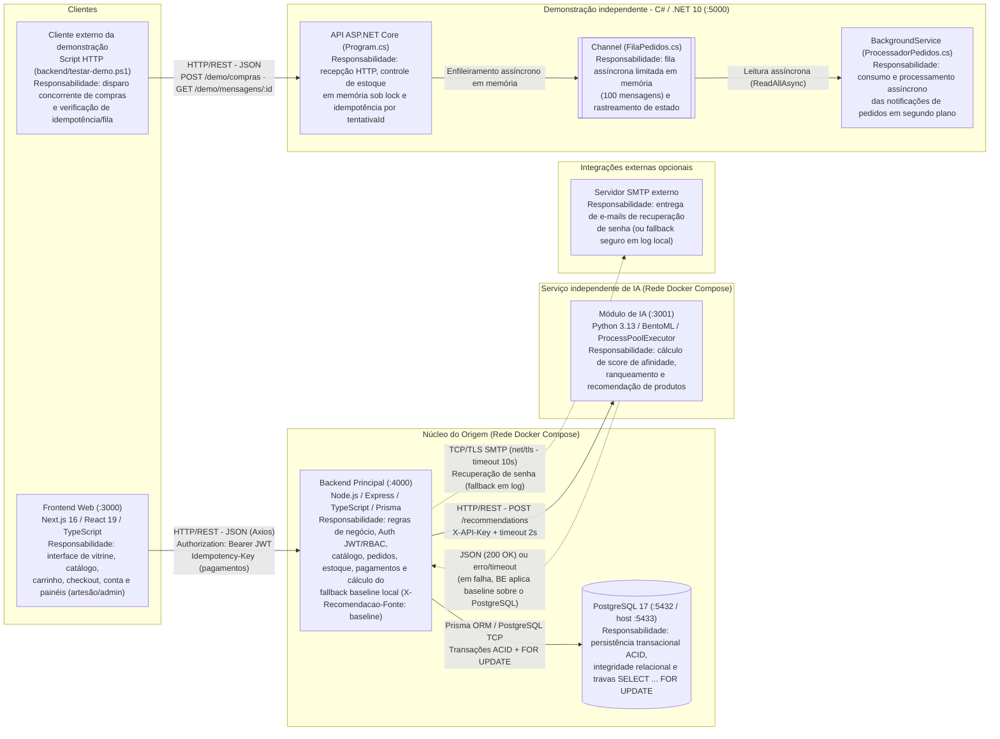

# Arquitetura Distribuída — Marketplace Origem

**Data:** 24/11/2026  
**Referência:** Parte 2 (FCCPD — Unidade 2) · Organização modular, comunicação entre serviços, diagrama distribuído e justificativa da separação.

---

## 1. Visão Geral dos Módulos e Serviços

O **Origem** é organizado em **4 serviços principais orquestrados via Docker Compose** (`compose.yaml`) — cada um em container próprio com responsabilidades, runtime e ciclo de vida independentes — além de **1 serviço auxiliar demonstrativo** isolado para estudo de concorrência em memória (`ADR-003`):

| Módulo / Serviço | Diretório | Runtime / Stack | Porta (Container / Host) | Responsabilidade Principal |
|---|---|---|---|---|
| **Frontend Web** | `frontend/` | Next.js 16 + React 19 + TypeScript | `3000` / `3000` | Interface de vitrine, catálogo, carrinho, checkout, conta do comprador, painel do artesão e painel administrativo; consumo HTTP centralizado em `src/lib/http.ts`. |
| **Backend Principal (API REST)** | `backend/app/` | Node.js 24 + Express + TypeScript + Prisma ORM | `4000` / `4000` | Regras de negócio, autenticação JWT + revogação persistente, controle de acesso por papel (RBAC), transações atômicas de pedido/estoque/pagamento, orquestração das recomendações (com cálculo local do *fallback baseline* sobre o PostgreSQL) e persistência. |
| **Módulo de IA (Recomendações)** | `modulo-ia/` | Python 3.13 + BentoML + Pydantic | `3001` / `3001` | Serviço especialista de cálculo de afinidade e ranqueamento de recomendações (`POST /recommendations` consumido pelo backend e `POST /recommendations/batch` paralelo com `ProcessPoolExecutor` para testes/benchmarks em lote). |
| **Banco de Dados Relacional** | `database/sql/` | PostgreSQL 17 | `5432` / `5433` | Persistência durável, integridade referencial, gatilhos/regras SQL (`01`–`09`), travas de linha (`FOR UPDATE`) e idempotência transacional. |
| **Servidor SMTP *(opcional)*** | `backend/app/src/lib/email.ts` | Sockets TCP/TLS nativos (`net`/`tls`) | `465` (TLS) / configurável | Entrega externa de e-mails de recuperação de senha (com fallback seguro em log local quando `SMTP_HOST` não está definido). |
| **Módulo de Concorrência *(demonstrativo)*** | `backend/backend/Origem.Concorrencia/` | .NET 10 / ASP.NET Core | `5000` *(fora do `compose.yaml`)* | Serviço independente da Parte 1 acionado por cliente externo (`backend/testar-demo.ps1`), demonstrando controle de concorrência em memória (`lock`), idempotência por `tentativaId` e fila assíncrona (`Channel` + `BackgroundService`). |

---

## 2. Diagrama da Arquitetura Distribuída

---

## 3. Comunicação Entre Módulos e Serviços

| Origem → Destino | Protocolo / Formato | Autenticação / Segurança | Tratamento de Falhas e Resiliência | Arquivos de Referência |
|---|---|---|---|---|
| **Frontend → Backend** | HTTP/REST (`JSON`) via Axios | `Authorization: Bearer <JWT>` (sessão com versão monotônica `sv` e revogação persistida); CORS restrito a `CORS_ORIGIN`; Helmet | Erros padronizados `{ mensagem }`; sessão expirada redireciona para `/entrar`; `Idempotency-Key` em pagamentos (`RN38`); `429 + Retry-After` no login (`TC11`) | `frontend/src/lib/http.ts`, `backend/app/src/index.ts`, `docs/ContratoDeAPI.md` |
| **Backend → Módulo de IA** | HTTP/REST (`JSON`): `POST /recommendations` *(obs.: `POST /recommendations/batch` é usado apenas em testes e benchmarks de lote)* | Cabeçalho `X-API-Key` (`RECOMENDACAO_API_KEY`) | Timeout estrito de `2.000 ms` (`RECOMENDACAO_TIMEOUT_MS`); se o `modulo-ia` retornar erro ou expirar, o próprio Backend calcula o algoritmo *baseline* sobre o PostgreSQL (`X-Recomendacao-Fonte: baseline`) sem indisponibilizar a vitrine | `backend/app/src/lib/modulo-ia.ts`, `backend/app/src/services/recomendacao.service.ts`, `modulo-ia/app/service.py` |
| **Backend → PostgreSQL** | TCP / protocolo PostgreSQL via Prisma ORM | Credenciais via `DATABASE_URL` (`.env`) | Transações ACID com `SELECT ... FOR UPDATE` em carrinho e pedidos; decremento condicional de estoque; índice único em `chave_idempotencia`; healthcheck `/health` (`SELECT 1` → `503` se indisponível) | `backend/app/src/lib/prisma.ts`, `backend/app/src/repositories/`, `database/sql/` |
| **Backend → SMTP** | SMTP sobre sockets nativos `net`/`tls` (`email.ts`) | Variáveis `SMTP_*` opcionais (`AUTH LOGIN` quando `SMTP_USER`/`SMTP_PASS` definidos) | Timeout de `10 s`; quando `SMTP_HOST` não está configurado em desenvolvimento, faz fallback seguro para log sem expor token na resposta HTTP | `backend/app/src/lib/email.ts`, `backend/app/src/services/auth.service.ts` |
| **Cliente externo (`testar-demo.ps1`) → `Origem.Concorrencia`** *(demonstrativo)* | HTTP/REST (`JSON`): `POST /demo/compras`, `GET /demo/mensagens/:id`, `GET /demo/estoque` | Isolado para o produto demonstrativo `prd_201` (sem integração com o `frontend/`) | Exclusão mútua (`lock`) em `EstoqueDemonstracao` + fila assíncrona em memória (`Channel<MensagemPedido>`, capacidade 100 em `FilaPedidos.cs`) consumida por `BackgroundService` (`ProcessadorPedidos.cs`); retorna `503` em fila cheia e `409` em estoque esgotado ou `tentativaId` conflitante | `backend/testar-demo.ps1`, `backend/backend/Origem.Concorrencia/Program.cs`, `FilaPedidos.cs`, `ProcessadorPedidos.cs` |

---

## 4. Justificativa da Separação de Cada Módulo/Serviço

### 4.1. Por que o **Frontend (`frontend/`)** é separado do Backend?
- **Separação entre apresentação e regra de negócio (`ADR-005` e `ADR-007`):** o navegador nunca acessa o PostgreSQL diretamente nem executa decisões críticas de preço, frete, estoque ou autorização. Toda validação de integridade, RBAC e posse de recurso permanece protegida na borda do servidor.
- **Implantação e otimização independentes:** permite servir SSR/estáticos em Next.js (inclusive em hospedagem como Vercel com rewrite `/api`) sem acoplar o bundle React ao ciclo de vida do servidor Express.

### 4.2. Por que o **Backend Principal (`backend/app/`)** é um monólito modular separado dos demais serviços?
- **Integridade transacional centralizada (`ADR-005` e `ADR-009`):** operações críticas do marketplace (checkout, baixa de estoque de peças únicas, pagamento com `Idempotency-Key`, cancelamento com reposição atômica) exigem transações ACID no mesmo banco relacional. Mantê-las numa única API modular dividida em camadas (`routes → controllers → services → repositories`) evita transações distribuídas complexas (como 2PC ou Sagas) mantendo baixo acoplamento interno (acesso ao Prisma isolado em `repositories/`).
- **Orquestração e ponto único de segurança (`ADR-006`):** concentra autenticação JWT, bloqueio contra força bruta (`tentativa_login`), revogação de sessão e contrato único da API (`docs/ContratoDeAPI.md`).

### 4.3. Por que o **Módulo de IA (`modulo-ia/`)** existe separado do Backend Node.js?
- **Isolamento de carga CPU-bound e proteção do *event loop*:** o Node.js utiliza *event loop single-threaded*, ideal para I/O concorrente (requisições HTTP e consultas SQL), mas vulnerável a bloqueios sob processamento intensivo de CPU. Isolar o motor de recomendações em um serviço Python próprio permite usar **`ProcessPoolExecutor`** em múltiplos núcleos (com ganho comprovado de **`2,79x` a `3,62x`** no pré-cálculo em lote, conforme `docs/medicao-ganho-paralelismo.md`) sem degradar a latência das compras, carrinho ou autenticação no backend principal.
- **Ecossistema especializado e evolução independente:** Python + BentoML viabiliza evoluir o motor de recomendação (ex.: embeddings, TF-IDF, modelos treinados) sem alterar a stack TypeScript/Express do marketplace nem exigir recompilação do backend.
- **Isolamento de falhas (*fault isolation*) e escalabilidade independente:** caso o `modulo-ia` sofra sobrecarga ou fique fora do ar, o timeout de `2 s` e o *fallback* local mantêm o catálogo e as vendas 100% operacionais; em picos de navegação, é possível escalar réplicas do `modulo-ia` independentemente da API transacional.

### 4.4. Por que o **PostgreSQL (`postgres`)** roda em container/serviço dedicado?
- **Ciclo de vida e durabilidade independentes (`ADR-001`):** o volume persistente (`origem_dados`) sobrevive a rebuilds e reinicializações do backend e do frontend.
- **Consistência concorrente nativa:** concentra restrições de integridade (`02_integrity_rules.sql`), gatilhos, índices e travas de linha (`FOR UPDATE`) em um SGBD relacional dedicado, servindo como única fonte de verdade transacional (sem estado volátil em memória no backend).

### 4.5. Por que o **`Origem.Concorrencia` (.NET 10)** existe separado do Backend principal?
- **Isolamento de experimento didático (`ADR-003`):** foi construído na Parte 1 para demonstrar em memória o uso de exclusão mútua (`lock`), idempotência por `tentativaId` e fila assíncrona produtor/consumidor (`Channel` + `BackgroundService`) sem contaminar nem colocar em risco o banco transacional PostgreSQL do marketplace em produção.

---

## 5. Documentos Relacionados
- [Arquitetura atual](arquitetura-atual.md), [Diagrama da arquitetura distribuída](diagrama-arquitetura-distribuida.md) e [Fluxo de comunicação](fluxo-comunicacao.md)
- [Diagrama de fluxo em camadas](diagrama-arquitetura.mmd) e [Persistência com Prisma](persistencia-prisma.mmd)
- [Evidências funcionais de comunicação](../evidencias-comunicacao-modulos.md)
- [ADR-001 (Persistência)](adr/ADR-001-persistencia-e-prisma.md), [ADR-003 (Módulo de concorrência)](adr/ADR-003-modulo-concorrencia.md), [ADR-005 (Cliente-servidor / monólito modular)](adr/adr-005-adotar-arquitetura-cliente-servidor-com-monolito-modular-em-camadas-para-proteger-a-integridade-das-operacoes.md) e [ADR-009 (Idempotência e transações)](adr/adr-009-adotar-chaves-de-idempotencia-e-transacoes-atomicas-no-checkout-e-pagamento.md)
- [Medição de ganho do paralelismo](../medicao-ganho-paralelismo.md), [Interpretação dos resultados](../medicao-interpretacao-paralelismo.md) e [Relatório consolidado de decisões técnicas](../relatorio-interpretacao-decisoes-tecnicas.md)
