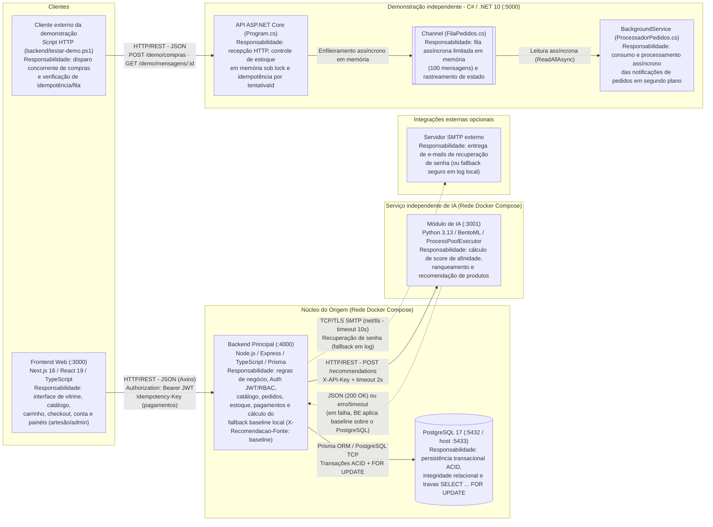

# Arquitetura Distribuída — Projeto Origem

## 1. Diagrama da Arquitetura Distribuída

## 2. Responsabilidades e Correspondência com o Código

- **Marketplace Origem (`frontend/` `:3000`, `backend/app/` `:4000`, `PostgreSQL` `:5432` / host `:5433`):** fluxo principal via HTTP/REST/JSON (`frontend/src/lib/http.ts`) autenticado por `Authorization: Bearer <JWT>` (e `Idempotency-Key` no pagamento), persistência relacional ACID com travas `SELECT ... FOR UPDATE` no PostgreSQL via Prisma (`backend/app/src/lib/prisma.ts`) e envio opcional de e-mails de recuperação via sockets nativos `net`/`tls` (`backend/app/src/lib/email.ts`, com fallback em log local).
- **Serviço de Recomendação (`modulo-ia/` `:3001`):** recebe `POST /recommendations` autenticado por `X-API-Key` com timeout de `2s` (`backend/app/src/lib/modulo-ia.ts`); em caso de resposta `200 OK`, o Backend retorna `X-Recomendacao-Fonte: ia`, e em falha ou tempo esgotado o próprio Backend calcula localmente o *fallback baseline* sobre o catálogo aprovado no PostgreSQL (`X-Recomendacao-Fonte: baseline` em `backend/app/src/services/recomendacao.service.ts`). O endpoint `POST /recommendations/batch` é disponibilizado para pré-cálculo paralelo em lote em testes e benchmarks.
- **Demonstração de Concorrência .NET 10 (`backend/backend/Origem.Concorrencia/` `:5000`):** módulo demonstrativo independente do checkout principal, sem persistência no PostgreSQL e acionado por cliente externo (`backend/testar-demo.ps1`). `Program.cs` (`EstoqueDemonstracao`) controla estoque e idempotência por `tentativaId` sob `lock`, `FilaPedidos.cs` implementa a fila assíncrona limitada em memória via `Channel` (100 mensagens) e `ProcessadorPedidos.cs` (`BackgroundService`) consome os itens de forma assíncrona via `ReadAllAsync`.
