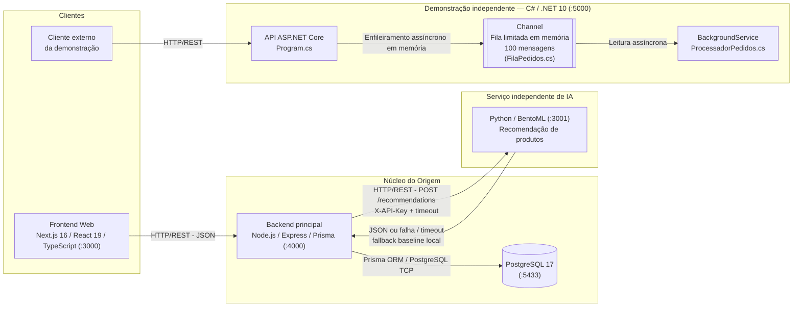

# Arquitetura Distribuída — Projeto Origem

## 1. Diagrama da Arquitetura Distribuída

## 2. Responsabilidades e Correspondência com o Código

- **Marketplace Origem (Frontend `:3000`, Backend `:4000`, PostgreSQL `:5433`):** fluxo principal via HTTP/REST/JSON e persistência relacional no PostgreSQL via Prisma.
- **Serviço de Recomendação (Módulo de IA `:3001`):** recebe `POST /recommendations` (e `POST /recommendations/batch`) autenticado por `X-API-Key` com timeout configurado (`2.000 ms`); em falha ou tempo esgotado, o Backend aplica o fallback *baseline* local.
- **Demonstração de Concorrência .NET 10 (`:5000`):** módulo demonstrativo independente do checkout principal e sem persistência no PostgreSQL; `Program.cs` recebe requisições e registra compras/solicitações, `FilaPedidos.cs` implementa a fila limitada em memória via `Channel` (`100` mensagens) e `ProcessadorPedidos.cs` (`BackgroundService`) consome os itens de forma assíncrona (fila, estoque demonstrativo e pedidos em memória).
- **Documentação completa:** ver [`arquitetura-distribuida.md`](arquitetura-distribuida.md).