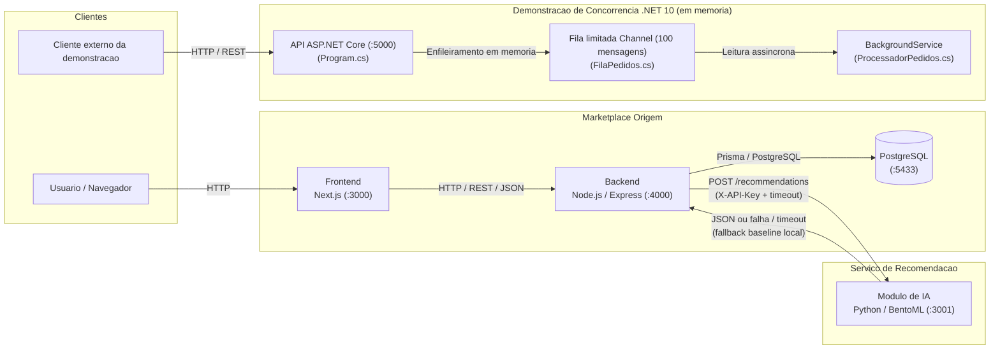

# Arquitetura Distribuida - Projeto Origem

## 1. Diagrama da Arquitetura Distribuida

## 2. Responsabilidades e Correspondencia com o Codigo

- **Marketplace Origem (Frontend :3000, Backend :4000, PostgreSQL :5433):** fluxo principal via HTTP/REST/JSON e persistencia relacional no PostgreSQL via Prisma.
- **Servico de Recomendacao (Modulo de IA :3001):** recebe POST /recommendations autenticado por X-API-Key com timeout configurado; em falha ou tempo esgotado, o Backend aplica o fallback aseline local.
- **Demonstracao de Concorrencia .NET 10 (:5000):** modulo demonstrativo independente do checkout principal e sem persistencia no PostgreSQL; Program.cs recebe requisicoes e registra compras/solicitacoes, FilaPedidos.cs implementa a fila limitada em memoria via Channel (100 mensagens) e ProcessadorPedidos.cs (BackgroundService) consome os itens de forma assincrona (com fila, estoque demonstrativo e pedidos em memoria).